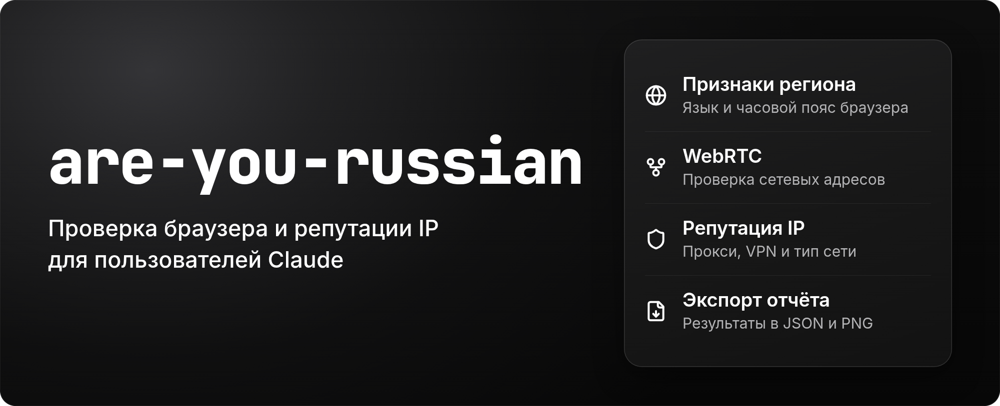

<p align="center">
  
</p>

Проверка настроек браузера и репутации выходного IP для пользователей Claude. Одна кнопка запускает измерения и собирает общий отчёт с подробными результатами. [Открыть сайт](https://are-you-russian.vercel.app/).

Русскоязычная адаптация [FuckClaude](https://github.com/LinXiaoTao/FuckClaude), исходная версия — [`e730162`](https://github.com/LinXiaoTao/FuckClaude/tree/e730162a5482c51317732c270e2d9f68ca79c858).

## Руководства

[Пять коротких материалов](https://are-you-russian.vercel.app/guides/) о результатах проверки, окружении Claude и сети. Статьи содержат ссылки на первоисточники и дату редакции.

| Материал | Что разобрано |
| --- | --- |
| [Что показывает проверка](https://are-you-russian.vercel.app/guides/antiban-essentials/) | Индекс браузера, репутация IP и пределы выводов |
| [Браузер и региональные признаки](https://are-you-russian.vercel.app/guides/environment-cleanup-and-ip-setup/) | Часовой пояс, языки, шрифты и WebRTC |
| [Claude Cage](https://are-you-russian.vercel.app/guides/claude-cage/) | Изолированная среда и наш опыт проверки |
| [VPS и маршрут к Claude](https://are-you-russian.vercel.app/guides/vpn-and-proxy-selection/) | Выходной IP, DNS и необходимые домены |
| [Как различать ошибки доступа](https://are-you-russian.vercel.app/guides/troubleshooting-guide/) | Сетевые сбои, HTTP-ошибки и ограничения запросов |

## Claude Cage

Для работы с Claude в отдельном окружении рекомендуем Claude Cage — открытый проект китайского сообщества. Он объединяет инструменты Claude, региональные настройки и контроль сетевого выхода. На 21 ноября 2026 года это единственное комплексное решение такого типа, которое автор этого проекта проверил в собственной конфигурации. [Репозиторий Claude Cage](https://github.com/Lee-xeo/Claude-Cage).

В нашей проверке прошли 11 критических проверок Cage, включая маршрут, DNS и сетевую изоляцию. Сторонняя оценка репутации осталась неизвестной. Это результат конкретной конфигурации. Рабочий прокси нужен отдельно, а решения об ограничениях аккаунта принимает Anthropic. Возможности актуальных версий описаны у разработчиков. [Документация Cage](https://claude-cage.com/docs/).

## Собственный VPS

Сервер позволяет управлять выходным IP и маршрутом. Для Claude важны согласованный сетевой выход, работа DNS, поведение IPv4/IPv6 и доступ ко всем доменам используемого клиента. Например, API использует `api.anthropic.com`, а вход и OAuth затрагивают `claude.ai`, `claude.com` и `platform.claude.com`. Дополнительные адреса зависят от функций. [Сетевые требования Claude Code](https://code.claude.com/docs/en/network-config).

Грамотное развёртывание VPS — сложная задача с защитой управления, сертификатами, маршрутизацией и дальнейшим обслуживанием. Объяснять её целиком здесь не имеет смысла. В руководстве описаны требования к результату, установка VPS и настройка Cage остаются за его рамками.

## Проверки

| Проверка | Вес |
| --- | --- |
| Часовой пояс | 34 |
| Языки браузера | 22 |
| Шрифты приложений | 12 |
| WebRTC | 10 |
| Браузер | 10 |
| Региональные форматы | 8 |
| Платформа и emoji | 4 |

Каждый вклад округляется перед сложением, как в оригинале. Недоступные данные расширяют диапазон результата; отсутствие измерения не считается отсутствием признака.

Детали включают сезонные смещения UTC, порядок языков, каждый проверенный шрифт, IPv4/IPv6 и типы ICE-кандидатов, Client Hints, региональные форматы и время измерения. WebRTC включается переключателем перед запуском. Общий отчёт можно скачать в JSON, сохранить в PNG или отправить через системное меню. Если отправка недоступна, картинка скачивается.

Репутация IP рассчитывается по исходному агрегатору FuckClaude и появляется в том же отчёте. Источники — proxycheck.io, AbuseIPDB и ipwho.is. Для браузерного индекса меньший балл означает меньше российских признаков; для репутации IP больший балл означает лучшую оценку сети. Без ключей или при сбое источников репутация может быть неизвестна. В подробностях доступны состояние источников, признаки сети и вычеты. Если запрос IP завершился ошибкой, браузерные результаты сохраняются.

Это авторская модель региональных признаков, а не ответ Anthropic. Сайт не читает аккаунт, установленный Claude Code или его системный промпт. Индекс не является вероятностью блокировки и не гарантирует доступ к сервису. Руководства помогают сопоставить результаты с настройками и ошибками конкретного клиента.

## Запуск

Node.js 22 или новее:

```sh
npm ci
npm run dev
```

Адрес: http://127.0.0.1:4321. `PORT` задаёт порт, `HOST` — адрес прослушивания; по умолчанию только localhost.

```sh
npm test
npm run build
npm start
```

`dist/` можно опубликовать как статический сайт: браузерные проверки и экспорт будут работать. Для `/api/ip` и `/api/check` нужен запущенный Node.js-сервер из этого репозитория. Статический хостинг сам API не выполняет. На публичном сервере используйте HTTPS и обратный прокси; запускайте Node.js на localhost.

### Репутация IP

При желании создайте `.env` по образцу `env.example`, задайте ключи и запустите:

```sh
node --env-file=.env scripts/serve.mjs
```

Не добавляйте ключи в клиентский код или Git. Лимиты и условия внешних источников определяются их тарифами. Без ключей доступна геоинформация ipwho.is; полноценная репутация не выдумывается.

### Vercel

Импортируйте репозиторий в Vercel. Выберите пресет Other и корневую папку `./`. Настройки сборки уже заданы в `vercel.json`: команда `npm run build`, выходная папка `dist`. Установка зависимостей — `npm ci`.

В Settings → Environments → Production → Environment Variables добавьте `PROXYCHECK_API_KEY` и `ABUSEIPDB_API_KEY` как Secret, если ключи уже получены. Для первого запуска можно оставить их незаданными. Ключи доступны только серверным функциям. После добавления или изменения переменных откройте Deployments и выполните Redeploy последней публикации.

На Vercel маршруты `api/ip.js` и `api/check.js` вызывают общий обработчик через стандартные Request/Response. Адрес посетителя берётся с помощью официального `ipAddress()` из `@vercel/functions`. Параметры `HOST`, `PORT` и `TRUSTED_PROXY_IPS` на Vercel задавать не требуется.

После публикации проверьте главную страницу, запуск общей проверки, `/api/ip?format=json` и `/api/check?format=json`. IP должен соответствовать соединению посетителя. Без ключей источники репутации отмечаются как ненастроенные.

Кеш и ограничение запросов хранятся в памяти отдельного экземпляра функции. На Vercel они сбрасываются при холодном старте и не суммируются между экземплярами. Лимиты внешних источников применяются отдельно.

При самостоятельном запуске Node.js сервер использует IP TCP-соединения и игнорирует forwarded-заголовки. За обратным прокси задайте `TRUSTED_PROXY_IPS` точным списком адресов прокси через запятую. Только от этих узлов принимается `X-Real-IP`; остальные заголовки не учитываются. Прокси должен перезаписывать X-Real-IP адресом клиента, а не копировать произвольный заголовок из запроса. Не добавляйте общедоступные адреса в доверенные.

Пример nginx для Node.js на той же машине:

```nginx
location / {
    proxy_pass http://127.0.0.1:4321;
    proxy_set_header X-Real-IP $remote_addr;
}
```

В этом случае `TRUSTED_PROXY_IPS=127.0.0.1`. Если сайт находится за CDN, сначала настройте проверку доверенных сетей CDN в прокси; иначе будет оценён IP CDN. Не доверяйте заголовкам CDN от произвольного клиента.

## HTTP API

- `GET /api/check?format=json` — российский профиль по Accept-Language и User-Agent, измеренный вес, диапазон и нормализованный балл только доступных сигналов. Сервер не видит локальный часовой пояс, шрифты, Intl и WebRTC.
- `GET /api/ip?format=json` — выходной IP, геоданные, ASN, репутация, признаки, вычеты и состояния источников. Параметр `ip` игнорируется.
- Без `format=json` ответ текстовый; также принимается `Accept: application/json`.
- Поддерживаются GET и OPTIONS. Запись не поддерживается. CORS разрешён для публичных результатов.
- Лимит: 30 запросов за минуту с IP на endpoint, ответ 429 с Retry-After: 60. Кеш IP — до 8 минут, не более 400 записей. Ограничения хранятся в памяти процесса, не являются общим лимитом нескольких серверов.

```sh
curl "https://are-you-russian.vercel.app/api/check?format=json" -H "Accept-Language: ru-RU,ru"
curl "https://are-you-russian.vercel.app/api/ip?format=json"
```

## Расширение

Готовый ZIP: `downloads/are-you-russian-extension.zip`. Распакуйте его, откройте `chrome://extensions`, включите режим разработчика и загрузите папку с manifest.json. Расширение автоматически в браузер не устанавливается.

Исходный Site Locale Control адаптирован: русский интерфейс, обнаружение Yandex Browser и фильтр российских шрифтов вместе с исходными наборами. Сохранены изменения часового пояса и сезонного смещения, языка, Intl, шрифтов, User-Agent и WebRTC для выбранных сайтов. По умолчанию всё выключено. Доступ к сайтам запрашивается отдельно. Кнопка восстановления удаляет изменения расширения; системные настройки и IP оно не меняет. Общая политика WebRTC требует отдельного разрешения и подтверждения.

Сборка и проверка:

```sh
npm --prefix extension ci
npm run extension:test
npm --prefix extension run typecheck
npm run extension:build
npm run build
```

ZIP входит в репозиторий, поэтому обычная сборка сайта не требует установки зависимостей расширения. После изменения расширения пересоберите ZIP.

Проверка в отдельном Chrome for Testing:

```sh
npm --prefix extension exec puppeteer browsers install chrome
npm --prefix extension run e2e
```

Если Chrome уже установлен в другом месте, укажите `CHROME_PATH`. Тест создаёт отдельный временный профиль, проверяет включение для сайта, часовой пояс и смещение, язык, вложенный фрейм и восстановление. Тестовый вариант с доступом к localhost не включается в распространяемый ZIP.

## Приватность

Браузерные результаты остаются на устройстве. В localStorage сохраняется только тема. JSON содержит выходной IP и может включать адреса WebRTC. В PNG сохраняются баллы и тип сети. Системная отправка начинается по нажатию кнопки. STUN Google получает сетевой адрес при включённой проверке WebRTC. Камера и микрофон не используются.

По нажатию «Начать проверку» сервер передаёт выходной IP источникам репутации и геоданных. Сервер кеширует ответ в памяти и ведёт счётчики запросов. Хостинг и обратный прокси могут иметь собственные журналы доступа. API-ключи хранятся в переменных окружения сервера. В проекте нет аналитики, рекламы, сбора аккаунтов или API-ключей Anthropic.

## Лицензии

[MIT](LICENSE), авторы Melidovskiy и LinXiaoTao. Лицензия Roboto: `assets/Roboto-OFL.txt`.

## Устройство проекта

| Путь | Назначение |
| --- | --- |
| `src/app.js`, `src/core/` | Запуск сканирования и исходные детекторы |
| `src/server/`, `api/` | Общая логика HTTP API и адаптеры Vercel |
| `docs/guides/` | Русскоязычные статьи в Markdown |
| `src/guides/catalog.js` | Темы, описания, источники и связи статей |
| `scripts/build-guides.mjs` | Статическая сборка каталога и страниц |
| `extension/` | Исходники расширения и его проверки |
| `assets/social-preview.png` | Обложка для Social Preview репозитория |
